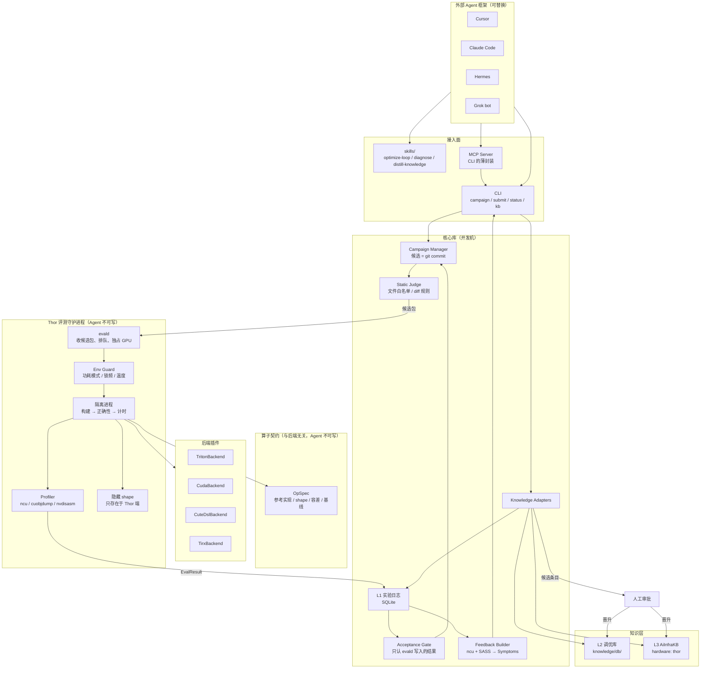
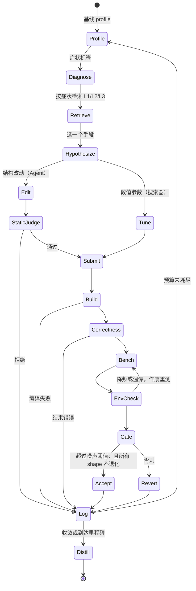
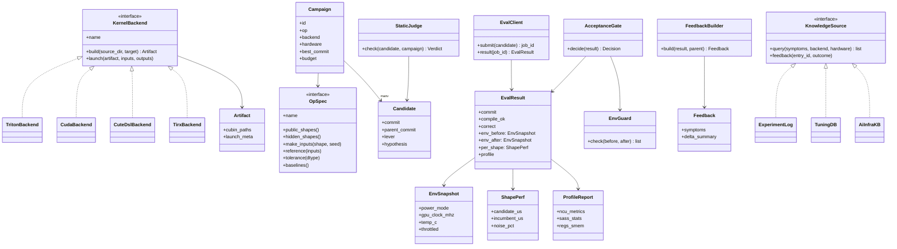

# kernel-agent-loop 架构

由 Agent 主导的 GPU 算子优化闭环：**模型提出改动 → 硬件评测与 profiling → 症状反馈 → 知识检索与沉淀**，循环迭代。

本仓库本身不调用大模型。Cursor、Claude Code、Hermes、Grok bot 等外部 Agent 框架负责“读反馈、提假设、改代码”；本仓库通过 skills、MCP、CLI 给它们提供工具，并担任**裁判**：评测、判定是否接受、管理知识。

## 1. 设计原则

1. **评测器归系统，不归 Agent。** Agent 只能修改 `ops/<op>/impls/<backend>/` 下的实现源码，不能碰算子契约、测试数据、参考实现和计时逻辑。
2. **接受与否只认评测守护进程写入的结果。** Agent 报告的数字不作为依据。
3. **每个候选只改一个手段（lever）。** 方便归因，也让知识能够沉淀。
4. **失败也要记录。** 实验日志既用于去重，也是以后 SFT/RL 的训练数据。
5. **便宜的事不交给大模型。** tile、stage 数这类数值参数用搜索器；大模型只做结构性改动。
6. **知识晋升必须经人工审批。** 共享知识库沿用 AiInfraKB 的 inbox 治理流程。

## 2. 架构图



### 模块职责

| 模块 | 运行位置 | 职责 |
|---|---|---|
| skills | Agent 框架内 | 用中性 Markdown 描述工作流，再由 agent-kit 同步到各框架的格式 |
| MCP / CLI | 开发机 | 唯一的对外接口；MCP 只负责转发 CLI 参数 |
| Campaign Manager | 开发机 | 管理优化任务；候选就是 campaign 分支上的 commit，回退就是切回父提交 |
| Static Judge | 开发机 | 确定性检查：只允许修改白名单文件，禁止读取测试数据、硬编码 shape |
| Acceptance Gate | 开发机 | 根据 `EvalResult` 判定接受或回退 |
| 实验日志 | 开发机 | 记录每次尝试的 diff、手段、假设、结果、症状，包括失败的尝试 |
| Feedback Builder | 开发机 | 把 ncu 指标和 SASS 统计映射成症状标签，并和父候选做差分 |
| Knowledge Adapters | 开发机 | 统一查询 L1/L2/L3，回写知识使用效果，生成待晋升的候选条目 |
| OpSpec | 两端 | 定义算子契约；隐藏 shape 只放在 Thor 端 |
| Backends | Thor | 把实现源码编译成 cubin，并负责启动 kernel |
| evald | Thor | 接收候选包，固定运行环境，在隔离进程里构建、验证、计时、profiling |

## 3. 单轮循环



图中 Diagnose、Retrieve、Hypothesize、Edit 由 Agent 框架执行，其余步骤由本仓库执行。

## 4. 类图



## 5. 关键设计

### 5.1 算子契约与后端分离

借鉴 TIRx-kernels 的 `KernelModule` 协议，但不直接依赖它。该协议把“测什么”和“怎么实现”放在同一个模块里，这里拆成两部分：

- `OpSpec` 归系统所有：输入生成、参考实现（用 fp32/fp64 计算）、按 dtype 设定的容差、公开 shape、隐藏 shape、基线实现。
- `KernelBackend` 是插件：把实现源码编译成 `Artifact`，并负责启动 kernel。

所有后端最终都产出 cubin，因此 SASS 和 ncu 是跨后端的统一反馈来源，症状映射只写一份。

### 5.2 防作弊

| 风险 | 对策 |
|---|---|
| 复用上一次的输出 | 每次运行前用 NaN 填满输出缓冲区 |
| 针对固定输入过拟合 | 每次评测用新的随机种子；隐藏 shape 只存在 Thor 端 |
| 硬编码 shape、读取测试数据 | Static Judge 做文件白名单检查和 diff 规则扫描 |
| kernel 实际没有执行 | 用 ncu 核对 kernel launch 数量 |
| 加速比不合理 | 超过 Thor 实测 roofline 的结果直接标为可疑，转人工复核 |
| Agent 谎报结果 | Gate 只读取 evald 写入实验日志的结果 |

### 5.3 测量纪律（Thor）

- 评测前固定 `nvpmodel` 功耗模式并执行 `jetson_clocks`；每个结果都附带 `EnvSnapshot`。
- 如果评测前后温度漂移超过阈值，或者检测到降频，结果作废并重测。
- 每次计时前 flush L2，取多次运行的中位数；基线在同一会话里重新测量。
- 只有加速超过噪声阈值，并且**所有 shape 都不退化**，才接受候选。
- CPU 和 GPU 共享 LPDDR5X 带宽：评测期间保证 CPU 侧没有其他负载；roofline 用部署时自己校准的实测上限，不用规格表的数字。
- Thor 的 SM 数远少于数据中心 GPU，wave 量化的影响不同。从数据中心 kernel 借鉴代码时，不要沿用按 148 个 SM 写死的默认值。

### 5.4 反馈

Feedback Builder 只给 Agent 少量高信号信息：排在前几位的症状标签、和父候选相比的指标变化、寄存器和 shared memory 用量。症状词表沿用 `tirx-codegen-tuning` 的 snake_case 标签（如 `long_scoreboard`、`register_spill`），没有合适的词再新增。

### 5.5 知识分层

| 层 | 内容 | 写入方 | 晋升门槛 |
|---|---|---|---|
| L1 实验日志 | 每次尝试的 diff、手段、假设、结果、症状 | 系统自动写入 | 不需要 |
| L2 调优库 | 可复用的 kernel 代码改法 | Distiller 草拟，人工审批 | 正确性通过，且实测有收益 |
| L3 AiInfraKB | 跨项目事实与基准，按硬件、模型索引 | 写入 AiInfraKB 的 `inbox/` | 治理 bot 审核后人工批准 |

L2 条目沿用 `tirx-codegen-tuning` 的格式（一个条目一个文件，Symptoms 是唯一索引），另加一行 `**Backends:**`。SASS 层面的经验通常跨后端通用，标为 `any`。

Planner 检索顺序：先查 L1 去重，再查 L2 找改法，最后查 L3 了解硬件特性。检索到的条目如果最终带来被接受的改动，就回写一次成功；没起作用也要回写，用来发现过期条目。

### 5.6 适配多种 Agent 框架

- skills 只维护一份，由 agent-kit 同步到各框架。
- MCP 与 CLI 共用核心逻辑；不支持 MCP 的框架直接调用 CLI。
- 可以请另一个框架或模型对 diff 给出“第二意见”，但结果只作参考，不作为门禁。

## 6. 仓库结构

```text
kernel-agent-loop/
  docs/architecture.md
  skills/                     # optimize-loop / diagnose / distill-knowledge
  ops/<op>/spec.py            # OpSpec
  ops/<op>/impls/<backend>/   # Agent 唯一可写的区域
  knowledge/db/               # L2 调优库条目
  src/kernel_agent_loop/
    core/                     # campaign、gate、static judge、实验日志
    backends/                 # triton / cuda / cute / tirx
    evald/                    # Thor 端守护进程、环境守卫、隔离运行
    feedback/                 # ncu + SASS → symptoms
    knowledge/                # L2 与 AiInfraKB 适配
    cli.py
    mcp.py
  tests/
```

## 7. 分阶段计划

| 阶段 | 内容 | 验证 |
|---|---|---|
| 0 | 在 Thor 上验证各后端工具链，并校准带宽和算力上限 | 各后端的 vector add 都能编译运行，校准数字落盘 |
| 1 | `OpSpec`、`CudaBackend`、本地 evald、实验日志、Gate；以 RMSNorm 跑通“提交 → 评测 → 接受或回退” | 故意写错和故意变慢的候选必须被拒绝 |
| 2 | 防作弊：隐藏 shape、输出投毒、Static Judge | 一组作弊候选测试必须全部被拦下 |
| 3 | ncu + SASS 接入，Feedback Builder，L2 检索 | 已知症状的 kernel 输出预期标签 |
| 4 | skills + MCP，至少两个框架跑通完整 campaign | 同一个 campaign 分别用 Cursor 和 Claude Code 跑完 |
| 5 | Triton 后端、Distiller、AiInfraKB 回写 | 晋升条目通过 AiInfraKB lint |

## 8. 待验证风险

- Triton、CuTe DSL 对 Thor 架构的支持程度未确认，在阶段 0 验证；不支持的后端先不接入。
- Jetson 上运行 ncu 需要 root 或额外的 profiling 权限，evald 的部署方式要提前确定。
- Thor 对应的 nvcc `-arch` 取值需要在真机上确认；CUDA 后端默认从设备查询 compute capability，不写死。

## 9. 第 1、2 阶段的实现约定

### 9.1 已定的选择

| 问题 | 选择 |
|---|---|
| Gate 和实验日志放哪 | 开发机 |
| 开发机与 Thor 通信 | SSH 同步调用：一次提交等评测结束再返回；GPU 互斥用 `flock` |
| CUDA 后端 | `nvcc -cubin` 编译，`cuda-python` driver API 加载和启动 |
| 第一个算子 | RMSNorm |

**已接受的风险**：Agent 在开发机上有 shell 权限，理论上可以改实验日志或绕过 CLI 直接登录 Thor。“只认 evald 写回的结果”在这种部署下靠约定维持，不是强制保证。以后需要更强的保证时，把 Gate 和权威存储移到 Thor，并给开发机配只能调用 evald 的受限 SSH key。

### 9.2 候选包

候选包是一个 tar.gz，只有两类成员：

- `meta.json`：campaign、commit、父 commit、算子、后端、手段、假设。
- `impl/<相对路径>`：`ops/<op>/impls/<backend>/` 下的文件。

evald 用 campaign 创建时锁定的可信源码树，把 `impl/` **整体替换**进对应目录后再构建（不是合并，候选删掉的文件不会残留）。出现以下任一情况，整个包被拒绝，目标目录不做任何改动：

- 成员不是 `meta.json`，也不在 `impl/` 下；
- 路径含 `..` 或是绝对路径；
- 成员是符号链接或硬链接；
- `meta.json` 里的算子或后端和 campaign 不一致。

因为算子契约、测试和计时代码不在包里，Agent 改了它们也到不了 Thor。

### 9.3 评测进程

- 父进程持有参考实现、隐藏 shape 和容差，负责生成输入和比对结果。
- 每个候选在新的子进程里运行，只拿到输入和 shape；设超时，在临时目录里运行。
- 隐藏 shape 放在 Thor 的 evald 配置里，不进仓库。

### 9.4 正确性检查

每个 shape 至少跑两轮，每轮用新的随机种子。每次运行前输出缓冲区填 NaN，运行后核对输入有没有被改写。任何一次不匹配、输入被改写、或候选抛异常，都判为不正确，并在失败原因里写明 shape 和类别（`mismatch`、`input_modified`、`error`）。

### 9.5 计时与判定

- 候选和**当前最优版本（incumbent）**在同一会话里交替运行，抵消温度和频率漂移。
- 每个 shape 得到一个 `ShapePerf`：候选和 incumbent 各自的逐轮中位数再取中位数；`noise_pct` 是 incumbent 逐轮中位数的极差除以中位数。
- 第一个候选没有 incumbent，只要正确且环境合格就接受，作为起点。
- Gate 的判定顺序：编译失败或不正确判 `reject`；环境不合格判 `invalid`（需要重测）；之后只有同时满足下面两条才判 `accept`，否则判 `revert`：
  - 各 shape 加速比的几何平均，超过 `1 + max(各 shape 的 noise_pct, min_gain_pct)`；
  - 没有任何 shape 比 incumbent 慢超过它自己的噪声。

### 9.6 CUDA 实现目录约定

```text
ops/<op>/impls/cuda/
  kernel.cu     # 一个或多个 extern "C" __global__ 函数
  launch.py     # launch_config(shape) -> kernel 名、grid、block、动态 smem、参数顺序
```

参数顺序里的名字，从输入、输出张量和 shape 的维度里取值。

### 9.7 测试

- 测试放在 `tests/`，按被测模块分目录。
- 不依赖 GPU 的逻辑（判定、环境检查、候选包、正确性、交替计时统计、Static Judge、实验日志、campaign 的 git 操作）用 numpy 和临时 git 仓库测试。
- 需要 Thor 的测试打 `thor` 标记，默认不跑，在 Thor 上用 `pytest -m thor` 执行。
